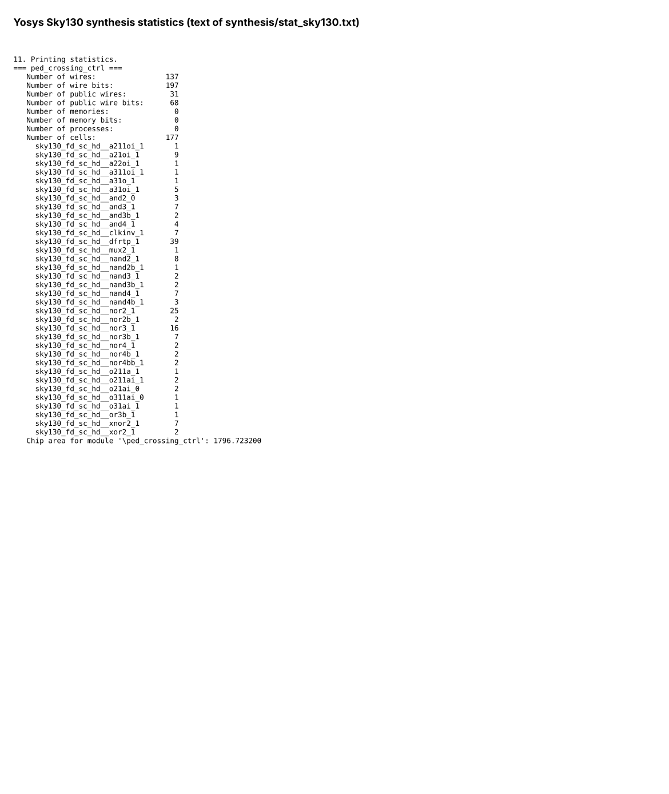
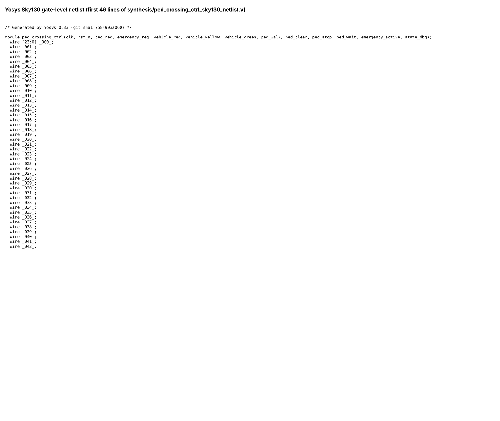
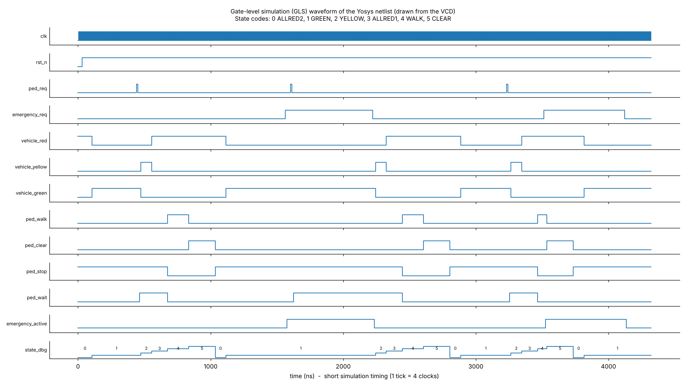
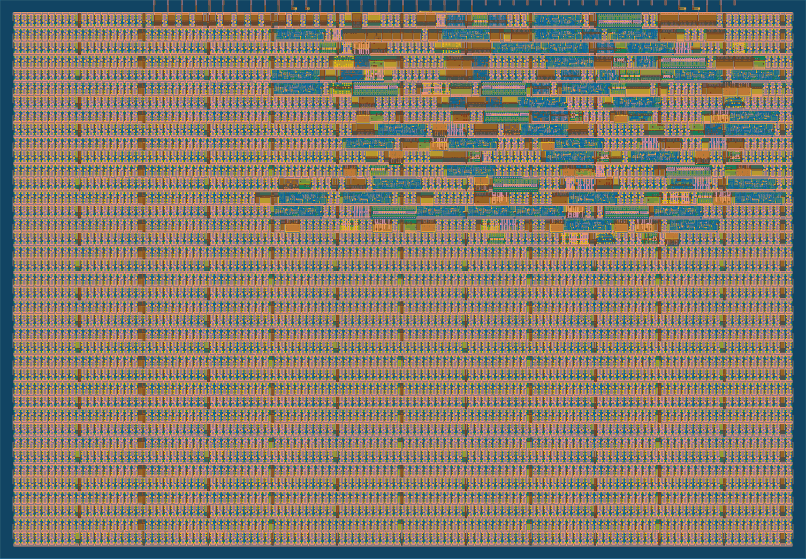

# Pedestrian Crossing Controller with Emergency Override – Assessment 1

## Introduction

This folder contains the work for Assessment 1: the design, simulation, synthesis, gate-level simulation and physical implementation (GDS) of a **pedestrian traffic light controller with emergency override**, written in Verilog HDL.

It is an educational design. It has not been fabricated and it is not meant for real traffic use.

The original project repository (with the cloud layout workflow) is here: https://github.com/aitharupesh002/ped-crossing-controller

## Objectives

- Design a pedestrian crossing controller as a finite state machine (FSM) in Verilog HDL.
- Keep vehicle "go" and pedestrian "walk" from ever being on together.
- Handle an emergency request safely (hold green, end the walk early, always show the clearance phase).
- Verify the design with a self-checking testbench and mutation testing.
- Generate and analyse waveforms from the simulation.
- Synthesise the design with Yosys.
- Run a gate-level simulation (GLS) and compare it with the RTL.
- Generate a GDS layout and check DRC, LVS and timing.

## Tools and Technologies

Verilog HDL, Icarus Verilog 12.0, Verilator 5.020, cocotb 2.1.0, Yosys 0.33, Python (matplotlib) for drawing waveform images, Tiny Tapeout flow (LibreLane: OpenROAD, Magic, KLayout, Netgen), SKY130 PDK, Git and GitHub Actions.

## Table of Contents

1. [Controller Design](#1-controller-design)
2. [RTL Simulation](#2-rtl-simulation)
3. [Waveform Analysis](#3-waveform-analysis)
4. [RTL Synthesis](#4-rtl-synthesis)
5. [Gate-Level Simulation](#5-gate-level-simulation)
6. [RTL vs GLS Comparison](#6-rtl-vs-gls-comparison)
7. [Physical Design and GDS](#7-physical-design-and-gds)
8. [Overall Result](#8-overall-result)
9. [Limitations](#9-limitations)
10. [Conclusion](#10-conclusion)

## 1. Controller Design

The controller is a 6-state Moore FSM (ALLRED2, GREEN, YELLOW, ALLRED1, WALK, CLEAR) with a clock prescaler, a tick counter, input synchronisers and a request latch.

**Inputs:** `clk`, `rst_n`, `ped_req`, `emergency_req`
**Outputs:** `vehicle_red`, `vehicle_yellow`, `vehicle_green`, `ped_walk`, `ped_clear`, `ped_stop`, `ped_wait`, `emergency_active`, `state_dbg[2:0]`

Design files (inside the `project` folder):

- `project/src/ped_crossing_ctrl.v` – the design
- `project/src/project.v` – Tiny Tapeout wrapper
- `project/verification/tb_ped_crossing_ctrl.v` – self-checking testbench
- `project/synthesis/ped_crossing_ctrl_sky130_netlist.v` – synthesised netlist
- `project/physical_design/tt_um_ped_crossing_ctrl.gds` – layout

## 2. RTL Simulation

The RTL was simulated with Icarus Verilog using a self-checking testbench with 15 directed tests (T01 to T15) and automatic monitors.

| Check | Result |
|---|---|
| Self-checking testbench | 400,038 checks, 0 errors |
| Mutation test (16 injected bugs) | all 16 caught |
| Production-timing smoke test | start-up all-red lasts exactly 20,000,000 clocks |
| cocotb tests | 6 of 6 passed |

Run it with `make sim` inside `project`. The log is `project/verification/sim_log.txt`.

## 3. Waveform Analysis

The waveform below was drawn by a script (`project/gls/make_waveforms.py`) from the simulation VCD file. It is not a GTKWave screenshot. State codes: 0 ALLRED2, 1 GREEN, 2 YELLOW, 3 ALLRED1, 4 WALK, 5 CLEAR.

### RTL Waveform

## 4. RTL Synthesis

The RTL was synthesised with Yosys 0.33 to the SKY130 high-density cell library.

| Item | Result |
|---|---|
| Standalone Yosys run | 177 cells, 1796.7 µm² |
| Synthesis inside the Tiny Tapeout flow | 195 cells, 2237.1 µm², 39 flip-flops |

### Synthesis statistics

### Gate-level netlist (first lines)

## 5. Gate-Level Simulation

The same RTL was synthesised again with the short simulation timing and simulated side by side with the RTL using identical inputs (`project/gls/`). This GLS uses Yosys generic gates with zero delay, not the SKY130 cells with real delays.

### GLS Waveform

## 6. RTL vs GLS Comparison

All outputs were compared on every clock: **432 clock samples compared, 0 mismatches** (`project/gls/rtl_vs_gls_log.txt`).

## 7. Physical Design and GDS

The layout was produced with the Tiny Tapeout GitHub Action (LibreLane) on the sky130A process, with a 20 ns target clock.

| Item | Result |
|---|---|
| Die size | 161.0 µm × 111.52 µm |
| Standard-cell area | 2966.6 µm² |
| Setup slack (worst corner / typical) | +8.36 ns / +13.9 ns |
| Hold slack (worst corner) | +0.123 ns |
| Timing violations | 0 across 9 corners |
| Magic DRC | 0 violations |
| KLayout precheck | 15 of 15 passed |
| LVS | circuits match uniquely |
| Estimated power | about 231 µW (a static estimate, not measured) |

Reports are in `project/physical_design/reports/`.

## 8. Overall Result

The controller was designed, verified, synthesised, checked by gate-level simulation and taken to a GDS layout with clean design-rule, layout-versus-schematic and timing checks. The RTL and GLS results agree for the tested sequence.

## 9. Limitations

- Educational design; not checked against any traffic-signal standard and not for real traffic.
- The testbench does not prove every possible input sequence.
- The gate-level simulation uses zero-delay generic gates; the gate-level test inside the Tiny Tapeout flow only checks the reset state.
- No chip was fabricated and the power value is a tool estimate.
- The button is assumed to be debounced and reset release is assumed to be in step with the clock.

## 10. Conclusion

Assessment 1 demonstrates the complete flow from a clearly defined application to a verified Verilog design, a synthesised netlist, a gate-level simulation that matches the RTL, and a GDS layout.
