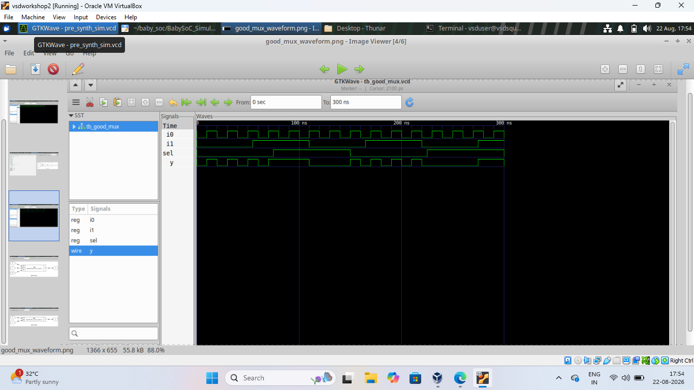
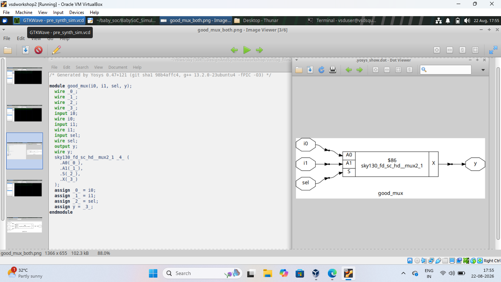

# Day 1 – Good MUX

A simple 2:1 multiplexer built in Verilog, simulated, and synthesized with Yosys.

**Inputs:** `i0`, `i1`, `sel` **Output:** `y`
`sel = 0` → `y = i0` | `sel = 1` → `y = i1`

## Simulation
Simulated with Icarus Verilog, waveform viewed in GTKWave.

## Synthesis
Synthesized with Yosys using the Sky130 standard cell library.

## What I Learned
- Writing a basic MUX in Verilog
- Simulating with Icarus Verilog and viewing waveforms in GTKWave
- Synthesizing RTL with Yosys and mapping to standard cells

## Conclusion
The MUX worked correctly in simulation and mapped cleanly to a Sky130 standard cell in synthesis.
