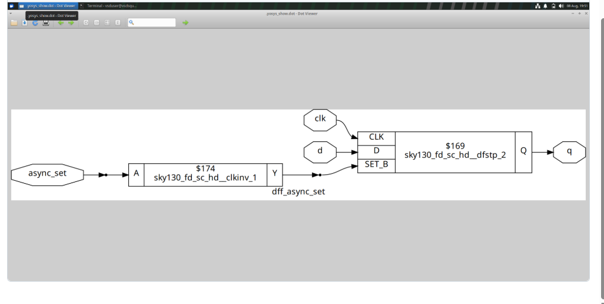
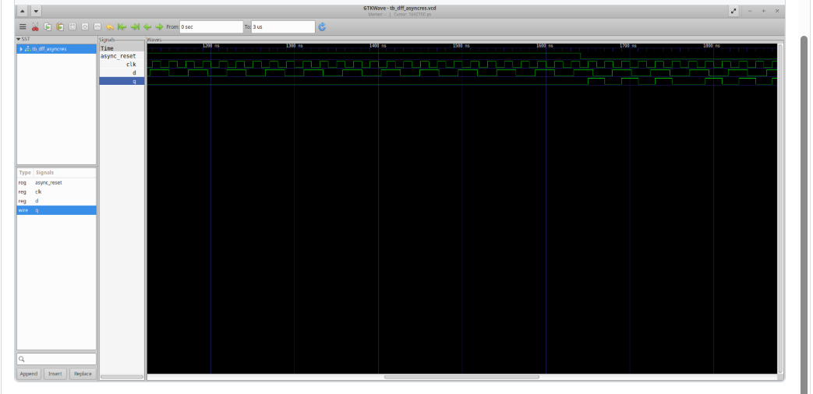
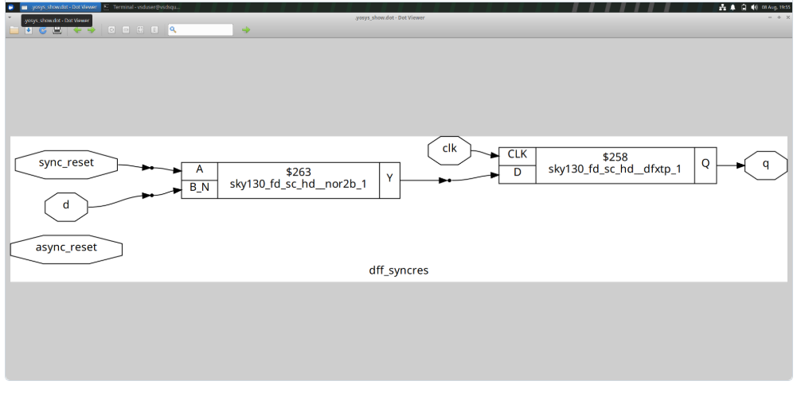
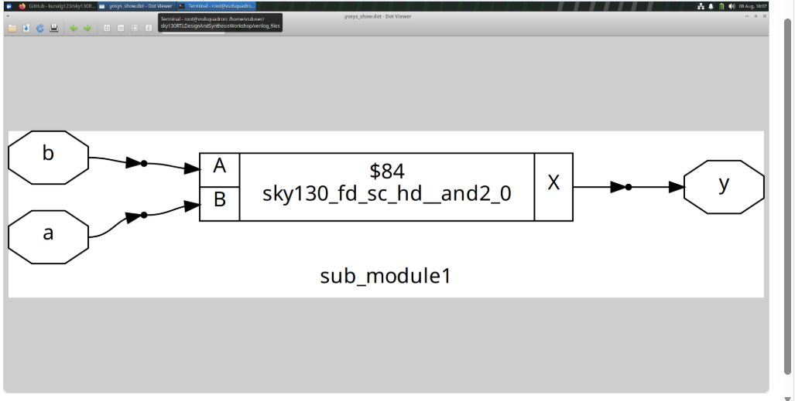
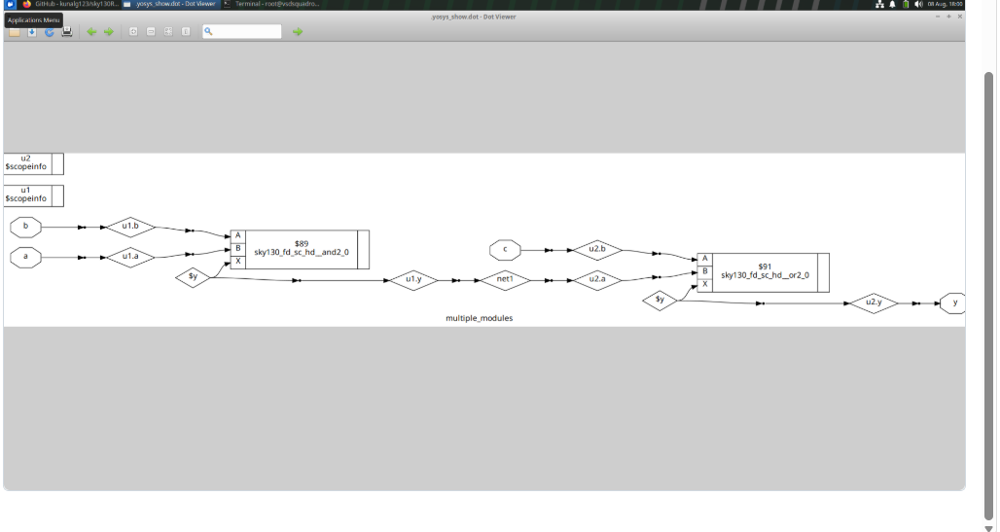

# Day 2 - Sequential Logic, Reset Techniques and Hierarchical Design

Sequential logic, reset styles, and hierarchical RTL design: D flip-flops with async/sync reset, sub-modules, multiple modules, and netlist flattening — simulated and synthesized with Yosys.

## Index
1. [Asynchronous Reset](#1-asynchronous-reset)
2. [DFF with Asynchronous Reset](#2-dff-with-asynchronous-reset)
3. [DFF with Synchronous Reset](#3-dff-with-synchronous-reset)
4. [Sub-Module Design](#4-sub-module-design)
5. [Multiple Modules](#5-multiple-modules)
6. [Flattening the Netlist](#6-flattening-the-netlist)
7. [What I Learned](#7-what-i-learned)

---

## 1. Asynchronous Reset

A D flip-flop (`clk`, `d`, `async_reset`, `q`) where reset forces the output immediately, independent of the clock.

## 2. DFF with Asynchronous Reset

Simulated waveform showing the output resetting immediately when `async_reset` is asserted, and normal clocked capture otherwise.

## 3. DFF with Synchronous Reset

A D flip-flop (`clk`, `d`, `reset`, `q`) where reset only takes effect on the active clock edge, unlike the asynchronous version.

## 4. Sub-Module Design

A smaller RTL module instantiated inside a parent module — splitting a design into reusable blocks. Synthesized with Yosys to see the resulting hierarchy.

## 5. Multiple Modules

A design split across several modules, each with one job, wired together to form the full circuit.

## 6. Flattening the Netlist

Yosys flattening removes module hierarchy, merging all sub-module logic into one top-level netlist — useful for whole-design optimization.

## 7. What I Learned
- Asynchronous reset acts immediately; synchronous reset waits for the clock edge
- How to build and instantiate sub-modules
- How multiple modules connect into a hierarchy
- What netlist flattening does and why it's used
- Simulating with GTKWave and synthesizing with Yosys

## Conclusion
Day 2 covered reset styles and hierarchical design — how RTL hierarchy is built with sub-modules and multiple modules, and how Yosys can flatten it into one netlist.
