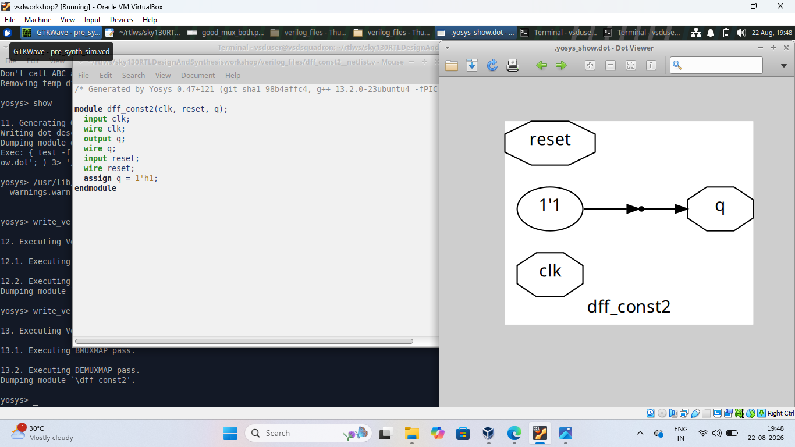
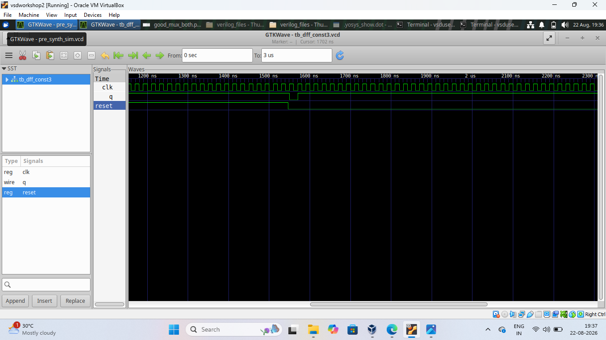
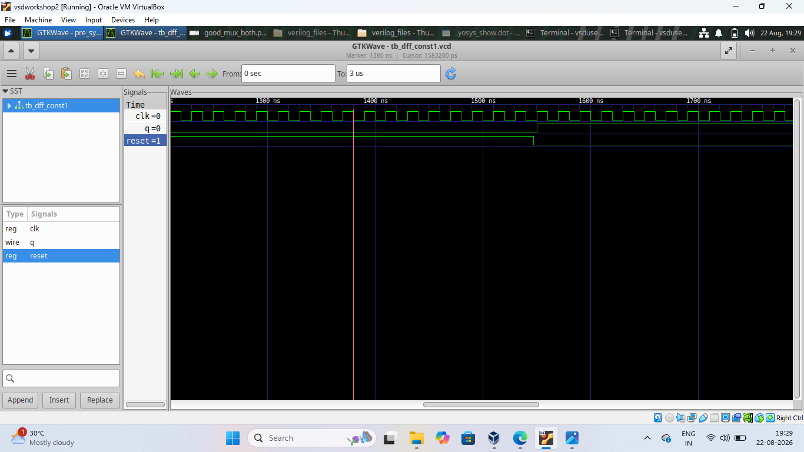
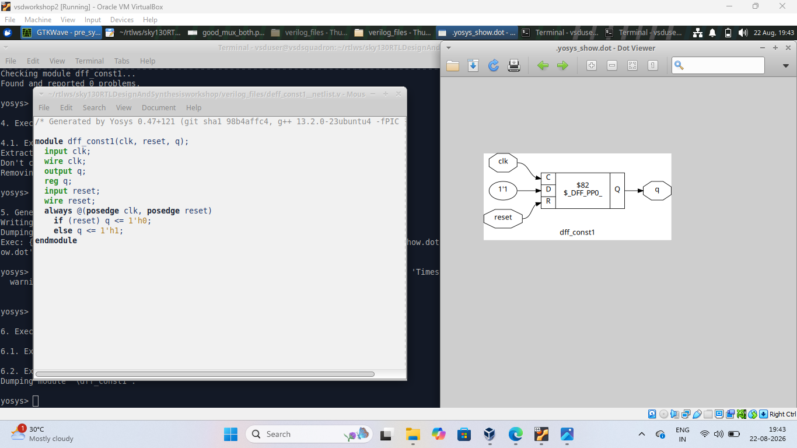
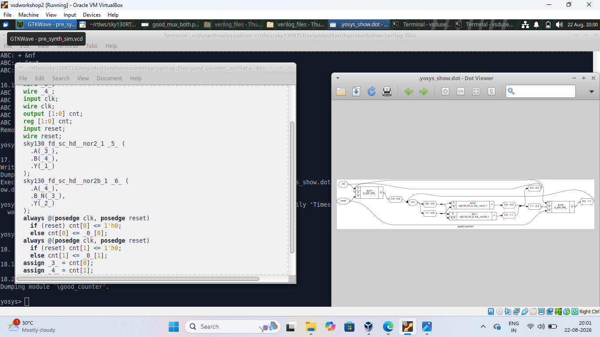
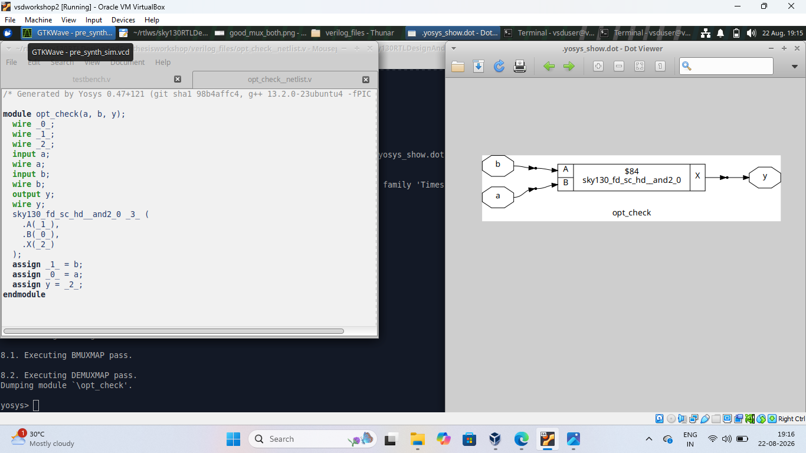
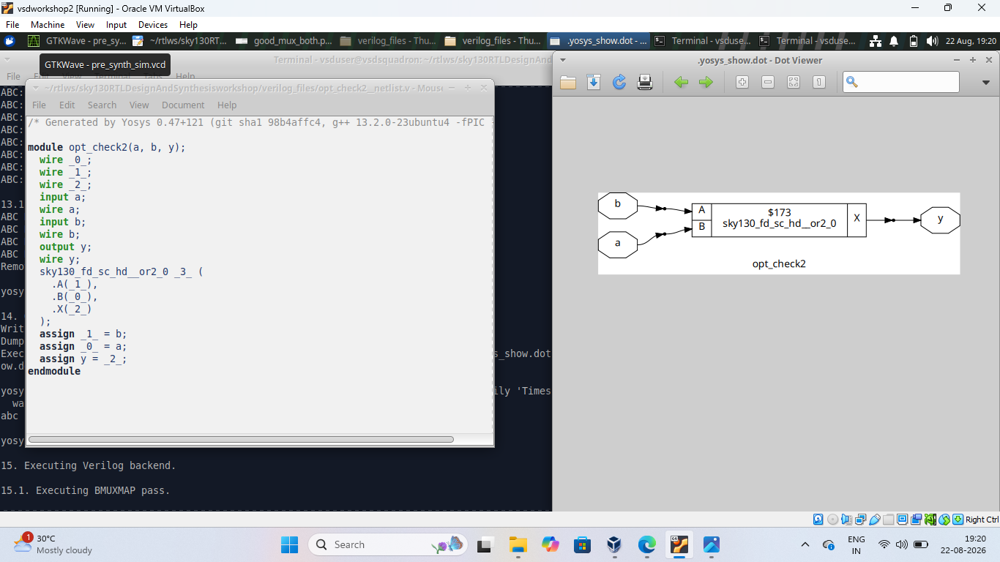
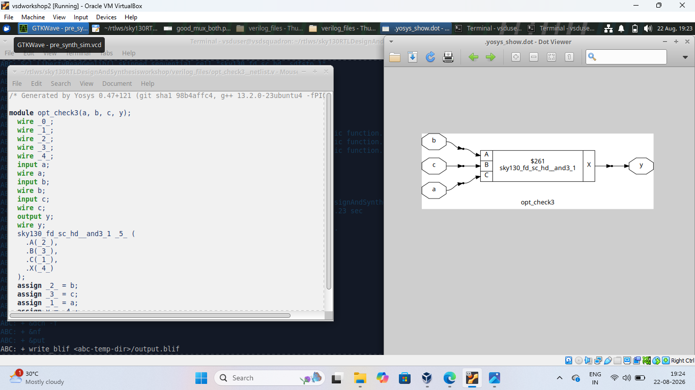

# Day 3 - RTL Optimization and Sequential Logic

How Yosys optimizes RTL during synthesis — D flip-flops with constant inputs, a counter, and combinational logic optimization examples.

## Index
1. [DFF Constant 2](#1-dff-constant-2)
2. [DFF Constant 3](#2-dff-constant-3)
3. [DFF Constant](#3-dff-constant)
4. [Good Counter](#4-good-counter)
5. [Optimization Checks](#5-optimization-checks)
6. [What I Learned](#6-what-i-learned)

---

## 1. DFF Constant 2

A D flip-flop (`clk`, `reset`, `q`) with a constant tied to its `D` input. Since the input never changes, Yosys simplifies the synthesized circuit.

## 2. DFF Constant 3

Another constant-input DFF example, showing Yosys again identifying and simplifying the constant behavior.

## 3. DFF Constant

A DFF whose output is driven by constant logic, showing how fixed values get recognized and simplified during synthesis.

## 4. Good Counter

A clocked counter with reset, simulated to confirm correct counting behavior and synthesized to a gate-level circuit.

## 5. Optimization Checks

Three simple combinational logic expressions (`opt_check`, `opt_check2`, `opt_check3`), each showing that Yosys doesn't translate RTL literally — it simplifies logic wherever possible.

## 6. What I Learned
- How constant inputs get simplified during synthesis (constant propagation)
- How counters are built with sequential logic
- How Yosys optimizes combinational logic instead of translating it literally
- Comparing RTL, simulation waveforms, and synthesized circuits

## Conclusion
Day 3 showed how Yosys optimizes RTL — removing unnecessary logic from constant-driven flip-flops and simplifying combinational expressions — while preserving the intended functionality.
