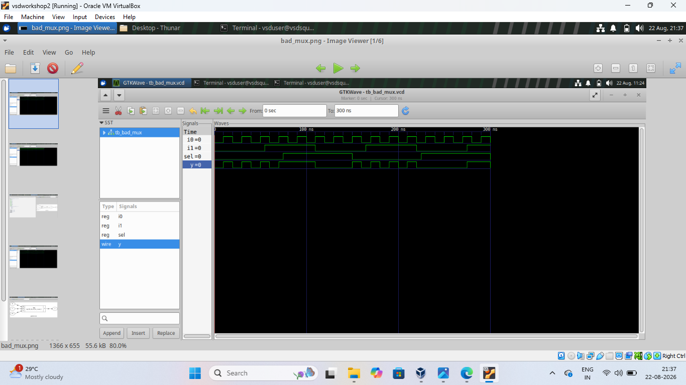
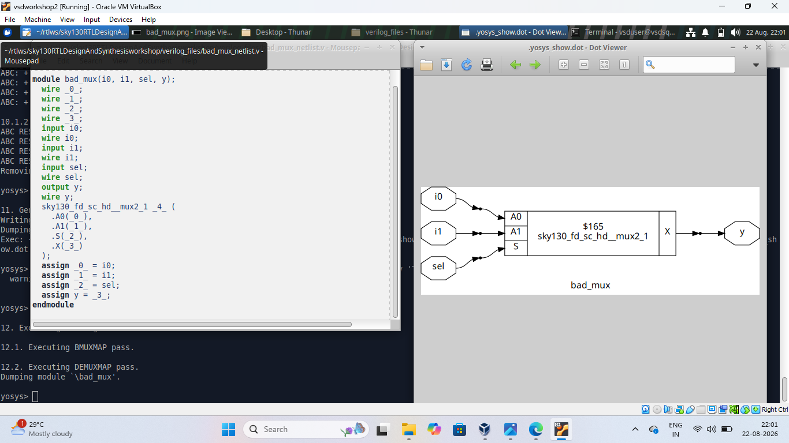
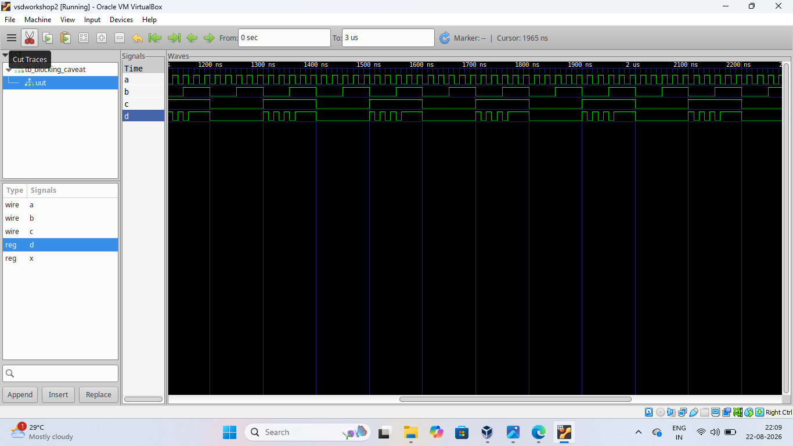
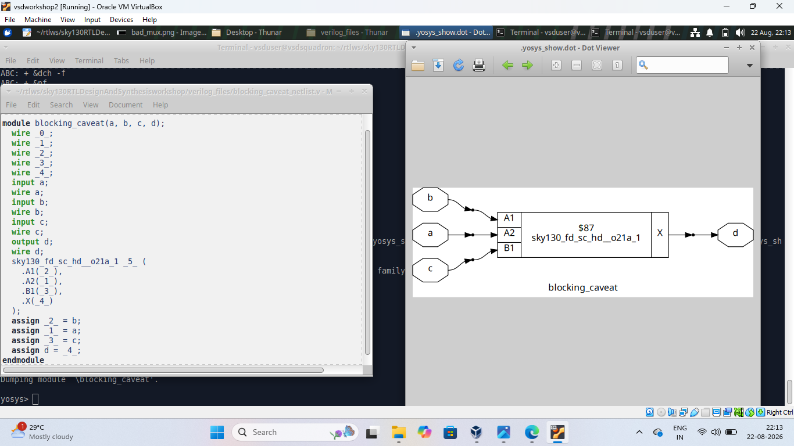
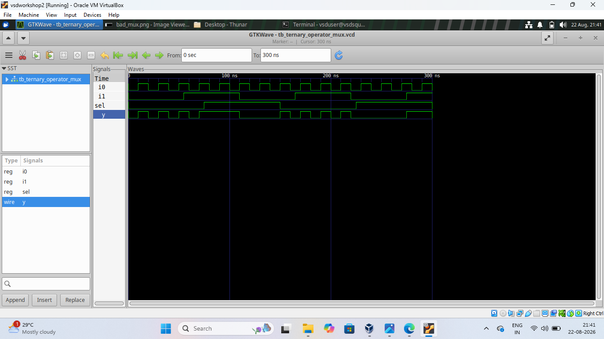
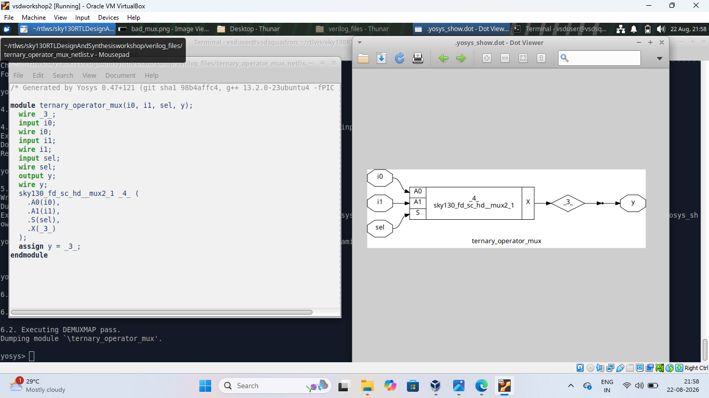

# Day 4 - RTL Coding Practices and MUX Design

How different RTL coding styles affect simulation and synthesis — a 2:1 MUX, blocking assignment behavior, and a ternary-operator MUX.

## Index
1. [Bad MUX](#1-bad-mux)
2. [Blocking Caveat](#2-blocking-caveat)
3. [Ternary Operator MUX](#3-ternary-operator-mux)
4. [What I Learned](#4-what-i-learned)

---

## 1. Bad MUX

A 2:1 MUX (`i0`, `i1`, `sel` → `y`): `sel = 0` selects `i0`, `sel = 1` selects `i1`. Simulated to check behavior, then synthesized into a standard MUX cell.

## 2. Blocking Caveat

Blocking assignments (`=`) execute sequentially inside a procedural block, so statement order can change the result — an important gotcha in combinational RTL.

## 3. Ternary Operator MUX

The same 2:1 MUX written compactly as `y = sel ? i1 : i0;`. Yosys recognizes this as MUX logic and maps it to the same standard cell.

## 4. What I Learned
- How a 2:1 MUX is described in RTL
- Why the order of blocking assignments matters
- How the ternary operator gives a compact, readable MUX description
- That different RTL styles can synthesize to the same hardware

## Conclusion
Day 4 highlighted how RTL coding style — plain if/else, blocking assignments, or the ternary operator — affects readability and simulation behavior, even when synthesis produces similar hardware.
