# Day 5 - Incomplete Conditional Logic and Case Statements

Incomplete `if`/`case` statements, latch inference, multiplexers, demultiplexers, and a Ripple Carry Adder — simulated with Icarus Verilog/GTKWave and synthesized with Yosys.

## Index
1. [Incomplete IF](#1-incomplete-if)
2. [Incomplete Case](#2-incomplete-case)
3. [Bad Case](#3-bad-case)
4. [Complete Case](#4-complete-case)
5. [MUX / DEMUX Generate](#5-mux--demux-generate)
6. [DEMUX Case](#6-demux-case)
7. [Partial Case Assignment](#7-partial-case-assignment)
8. [Ripple Carry Adder](#8-ripple-carry-adder)
9. [Latch Inference](#9-latch-inference)
10. [What I Learned](#10-what-i-learned)

---

## 1. Incomplete IF

An `if` with no `else` leaves the output unassigned for some conditions:

```verilog
always @(*) begin
    if (i0)
        y = i1;
end
```

When `i0 = 0`, `y` keeps its old value — so Yosys infers a latch. A second example (`incomp_if2`) shows the same issue with more inputs.

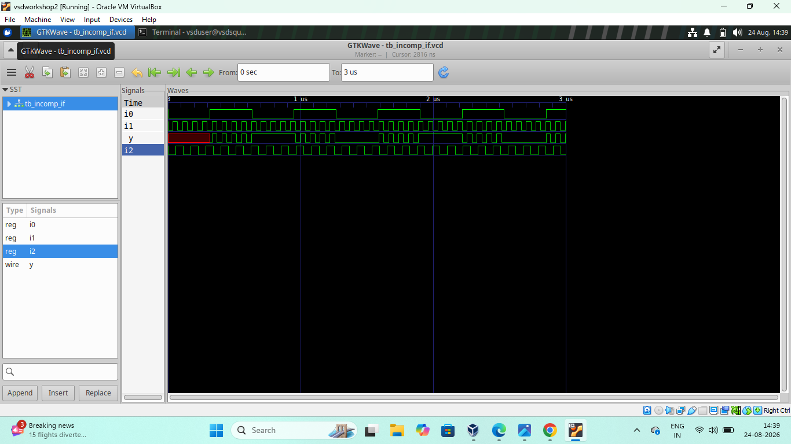
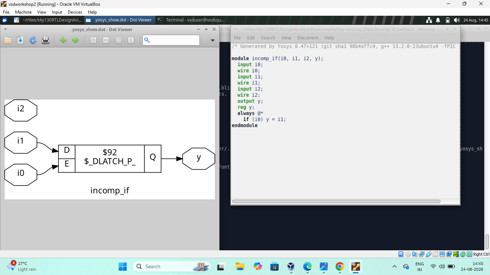
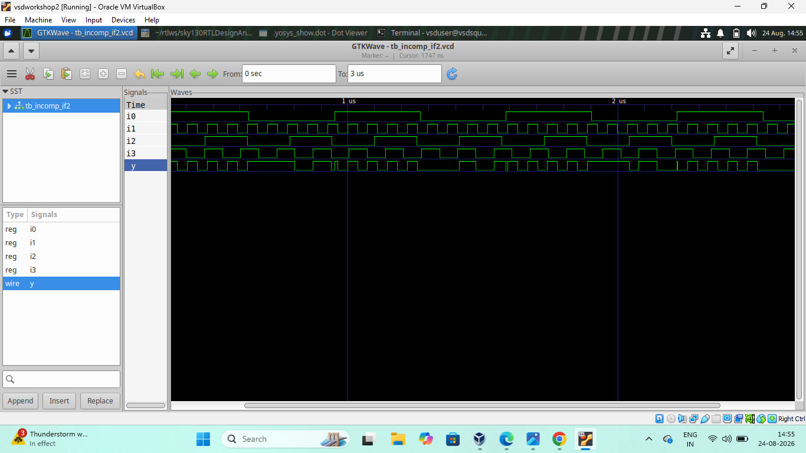
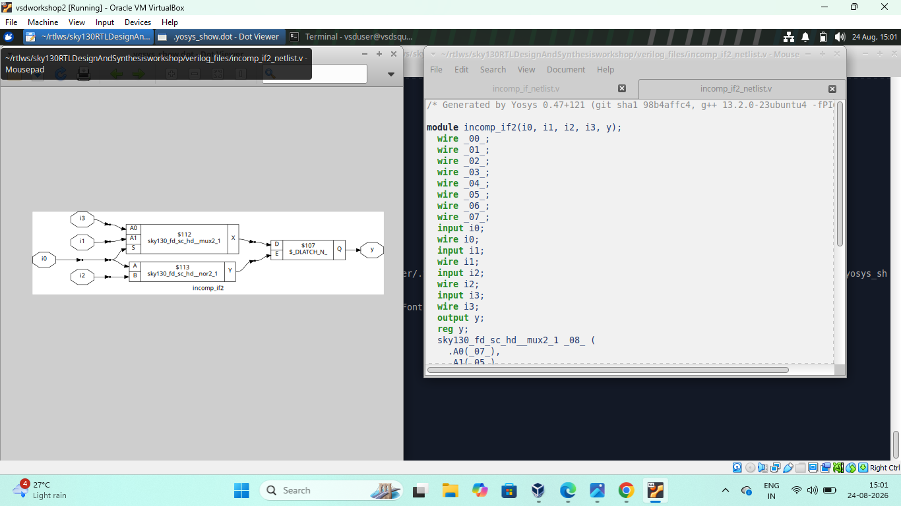

## 2. Incomplete Case

A `case` statement missing an assignment for some select values causes the same latch inference as an incomplete `if`.

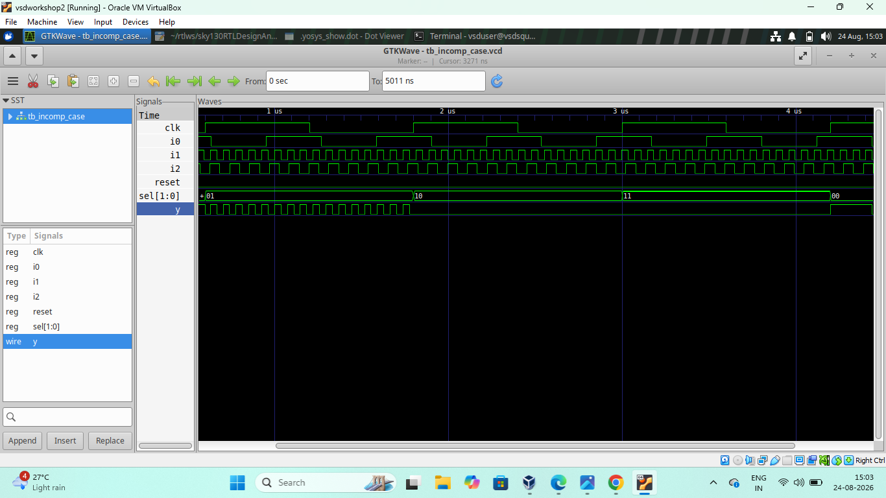


## 3. Bad Case

An improperly specified `case` statement, checked with simulation, gate-level simulation, and synthesis to see its effect on the generated hardware.

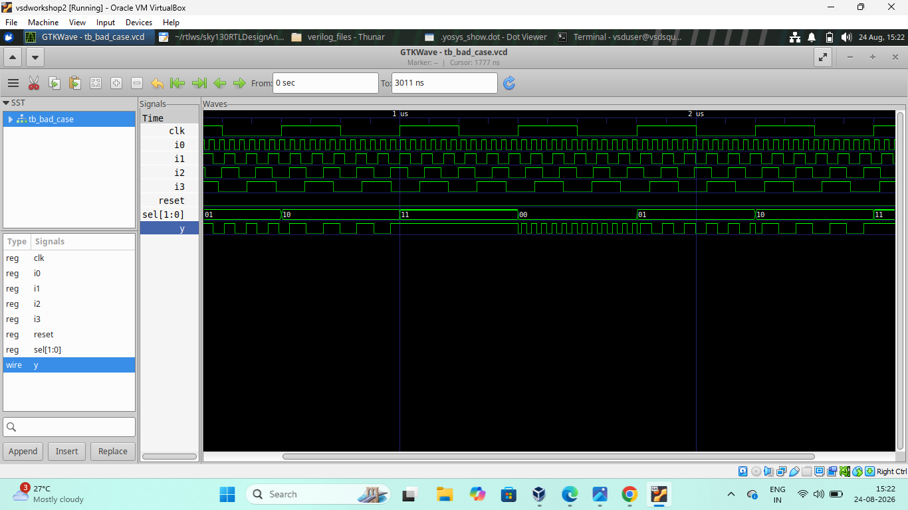


## 4. Complete Case

A `case` statement with every condition assigned. No latch is inferred — clean combinational logic.

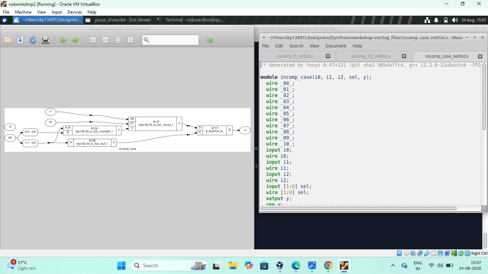

## 5. MUX / DEMUX Generate

A multiplexer selects one of several inputs; a demultiplexer routes one input to one of several outputs. Both built and verified with RTL simulation and synthesis.


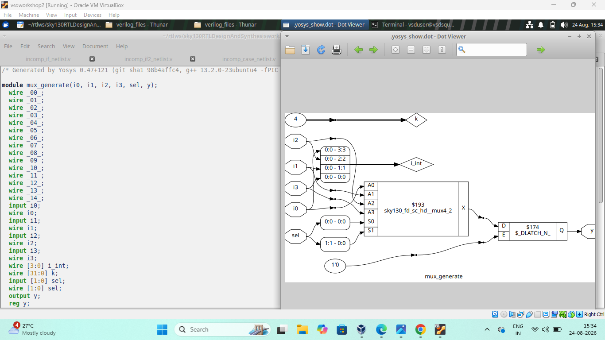
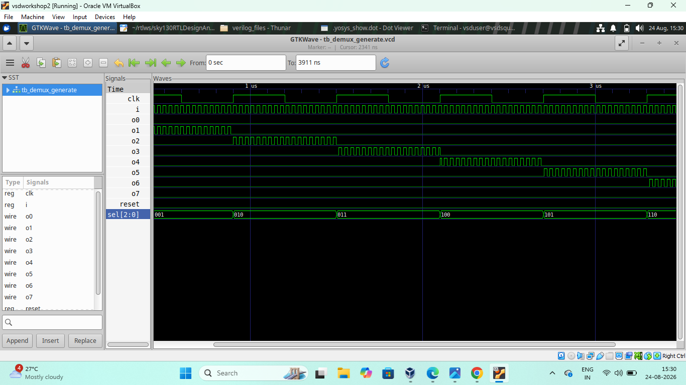

## 6. DEMUX Case

The same demultiplexer implemented with a `case` statement instead of generate logic.

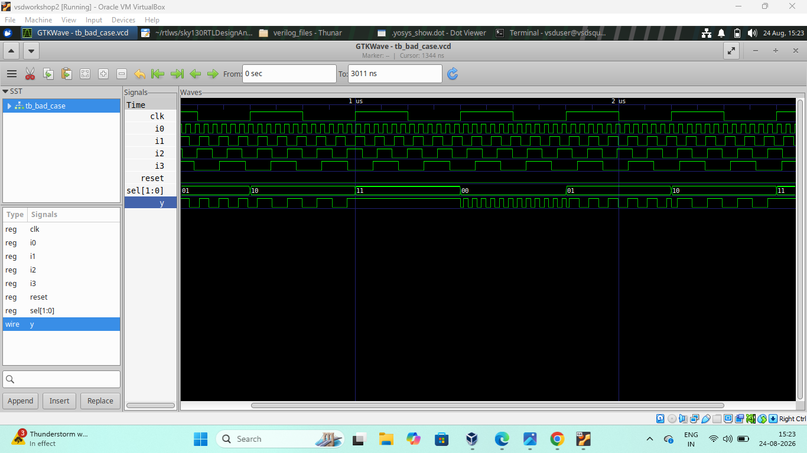

## 7. Partial Case Assignment

Only some `case` branches are assigned — again risking latch inference, confirmed by synthesis.

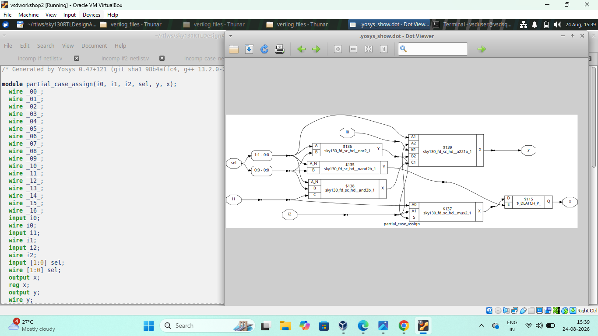

## 8. Ripple Carry Adder

Full adders chained so each carry-out feeds the next carry-in, adding two binary numbers bit by bit.

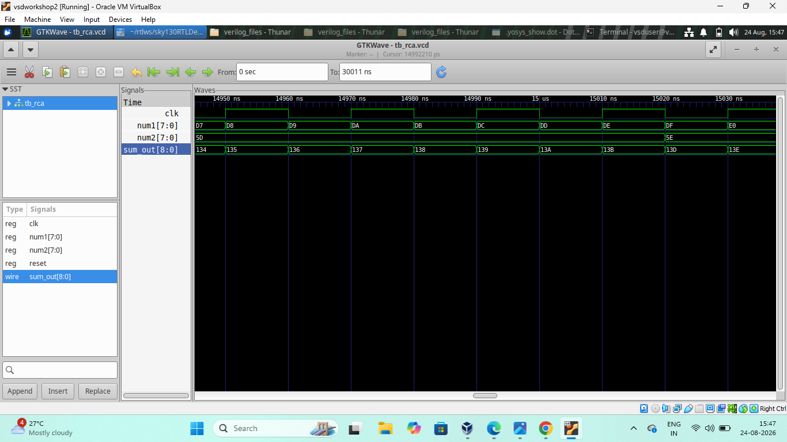

## 9. Latch Inference

A latch gets inferred whenever a combinational block doesn't assign its output for every possible condition (incomplete `if`/`case`). To avoid it:
- Assign outputs for every condition
- Use complete `if-else` and `case` statements
- Add default assignments where needed

## 10. What I Learned
- Incomplete `if`/`case` statements cause unwanted latch inference
- Complete conditions avoid latches and keep logic purely combinational
- How MUX and DEMUX circuits are built and verified
- How a Ripple Carry Adder performs binary addition
- Running RTL sim, gate-level sim, and Yosys synthesis, and comparing results

## Conclusion
Day 5 was about writing complete, latch-free combinational logic — incomplete `if`/`case` statements silently create latches, while complete assignments, MUX/DEMUX designs, and the Ripple Carry Adder showed clean RTL-to-hardware mapping.
