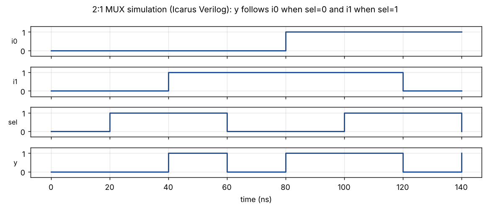
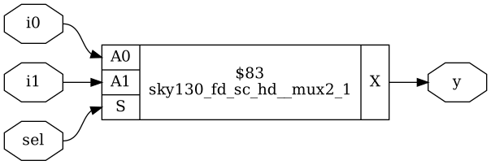

# Module 1 – Verilog RTL Design

## Overview

This module introduces Verilog HDL and the simulation-to-synthesis flow on a small design.

## Topics Covered

### 1. Verilog Basics

- Modules, ports and data types
- Continuous assignments and always blocks
- Combinational and sequential coding

### 2. Testbench and Simulation

- Design under test instance
- Input stimulus, clock and reset
- Running with Icarus Verilog and viewing in GTKWave

### 3. Synthesis with Yosys

- Reading the design and the liberty file
- Mapping RTL to standard cells
- Checking the generated netlist

## My Work

The 2:1 multiplexer (good_mux) in Day 1 follows exactly this flow.

- [Day_1](../Day_1)

## Examples and Results

These images come from small example designs that I wrote and ran with Icarus Verilog and Yosys (SKY130 HD cells) for this module. They are generated examples, not screenshots of a terminal session. The Verilog files are in the `examples` folder, so every result can be reproduced.

Example files: [good_mux.v](examples/good_mux.v), [tb_good_mux.v](examples/tb_good_mux.v)

### Simulation waveform

The output y copies i0 while sel is 0 and copies i1 while sel is 1.

### Synthesised netlist

Yosys maps the multiplexer to one SKY130 cell, `sky130_fd_sc_hd__mux2_1`.
