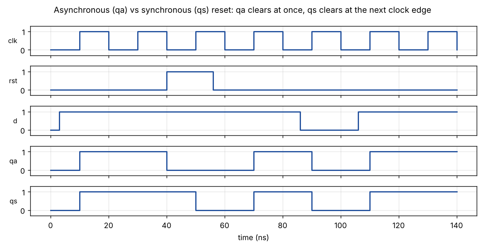
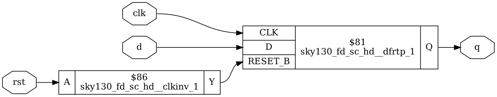
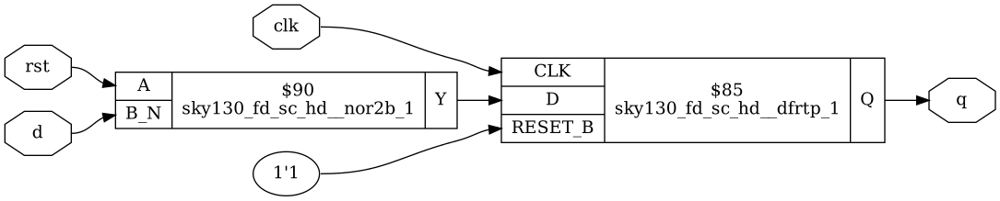

# Module 2 – Timing Libraries and Hierarchical Design

## Overview

This module looks at what is inside a standard-cell library and how larger designs are built from smaller modules.

## Topics Covered

### 1. Timing Libraries

- What a .lib file contains
- Cell delay, area and power data
- Different cell sizes and speeds

### 2. Hierarchical Design

- Sub-modules and module instantiation
- Hierarchical versus flat netlists
- Flattening in Yosys

### 3. Flip-Flops and Reset

- D flip-flop with asynchronous reset
- D flip-flop with synchronous reset
- Why reset style matters

## My Work

Day 2 covers the flip-flop reset styles, sub-modules, multiple modules and netlist flattening.

- [Day_2](../Day_2)

## Examples and Results

Simulation and synthesis results for small example designs, using Icarus Verilog and Yosys with the SKY130 HD cell library. The Verilog files are in the `examples` folder, so every result can be reproduced.

Example files: [dff_reset.v](examples/dff_reset.v), [tb_dff_reset.v](examples/tb_dff_reset.v)

### Asynchronous and synchronous reset

The reset pulse starts between clock edges. The asynchronous flip-flop (qa) clears at once. The synchronous flip-flop (qs) clears only at the next clock edge.

### Asynchronous reset flip-flop after synthesis

One `dfrtp_1` flip-flop with an active-low reset pin. An inverter turns the active-high reset into the active-low pin.

### Synchronous reset flip-flop after synthesis

One `dfrtp_1` flip-flop with a `nor2b` gate in front of D. The reset is part of the data logic, so no reset pin is used.
