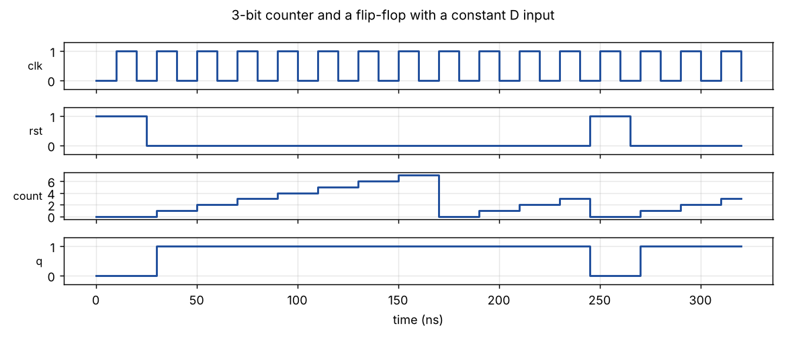
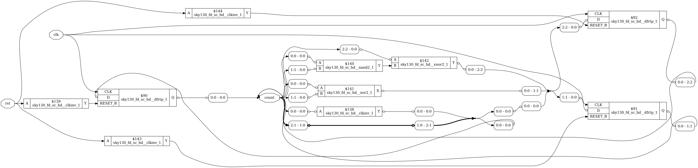
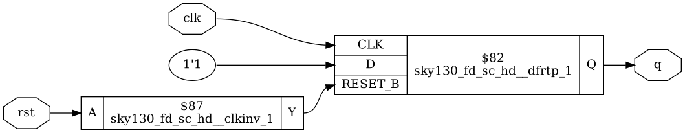

# Module 3 – Combinational and Sequential Logic Optimization

## Overview

This module shows how Yosys optimises logic, and how constants and unused logic change the synthesised result.

## Topics Covered

### 1. Combinational Optimization

- Constant propagation
- Boolean simplification
- Removal of redundant logic

### 2. Sequential Optimization

- Flip-flops with constant inputs
- Unused flip-flops being removed
- Counters and their optimisation

### 3. Checking the Result

- Compare RTL intent with the netlist
- Look at cell count after synthesis

## My Work

Day 3 has the constant-input flip-flops, the counter and the optimisation checks.

- [Day_3](../Day_3)

## Examples and Results

Simulation and synthesis results for small example designs, using Icarus Verilog and Yosys with the SKY130 HD cell library. The Verilog files are in the `examples` folder, so every result can be reproduced.

Example files: [counter.v](examples/counter.v), [tb_counter.v](examples/tb_counter.v)

### Counter and constant-input flip-flop

The 3-bit counter counts 0 to 7 and wraps. After reset the constant flip-flop (q) goes to 1 and stays there.

### Counter after synthesis

The 3-bit counter becomes 3 flip-flops plus a few gates (10 cells in total).

### Constant-input flip-flop after synthesis

With D tied to 1 the logic in front of the flip-flop disappears. Only the flip-flop and the reset inverter remain.
