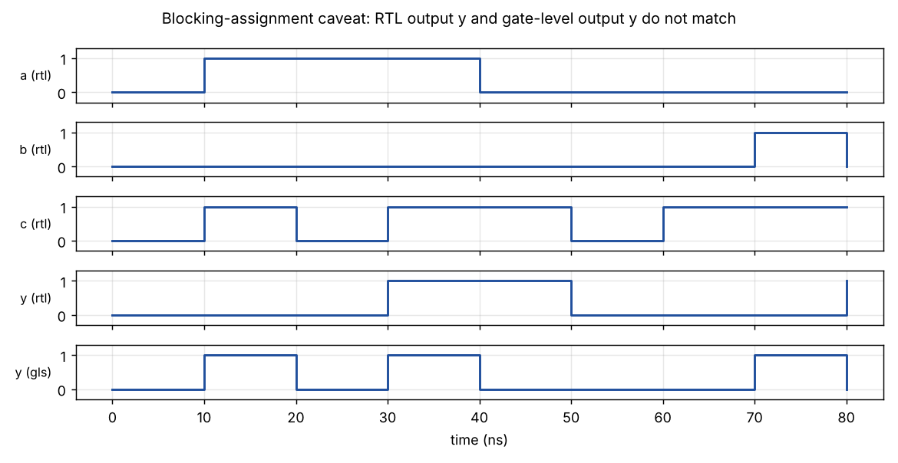

# Module 4 – Gate-Level Simulation and Verilog Coding Style

## Overview

This module explains why a design must be simulated again after synthesis, and how coding style can cause a mismatch.

## Topics Covered

### 1. Gate-Level Simulation (GLS)

- Simulating the synthesised netlist with the same testbench
- Comparing RTL and GLS waveforms
- Cell models needed for GLS

### 2. Synthesis-Simulation Mismatch

- Incomplete sensitivity lists
- Blocking versus non-blocking assignments
- The blocking-assignment caveat

### 3. Good Coding Practice

- Use non-blocking assignments for sequential logic
- Write complete conditions
- Use the ternary operator carefully

## My Work

Day 4 shows a bad MUX, the blocking caveat and the ternary-operator MUX. The Assessment project also compares RTL against gate-level simulation.

- [Day_4](../Day_4)
- [Assesment-1](../Assesment-1)

## Examples and Results

Simulation and synthesis results for small example designs, using Icarus Verilog and Yosys with the SKY130 HD cell library. The Verilog files are in the `examples` folder, so every result can be reproduced.

Example files: [blocking_caveat.v](examples/blocking_caveat.v), [tb_blocking_caveat.v](examples/tb_blocking_caveat.v)

### RTL against gate-level simulation

The code uses blocking assignments in the wrong order, so the RTL output y reads the old value of x. After synthesis the gate-level netlist computes y = (a OR b) AND c, so its output differs from the RTL. This is why a design must also be simulated after synthesis.
