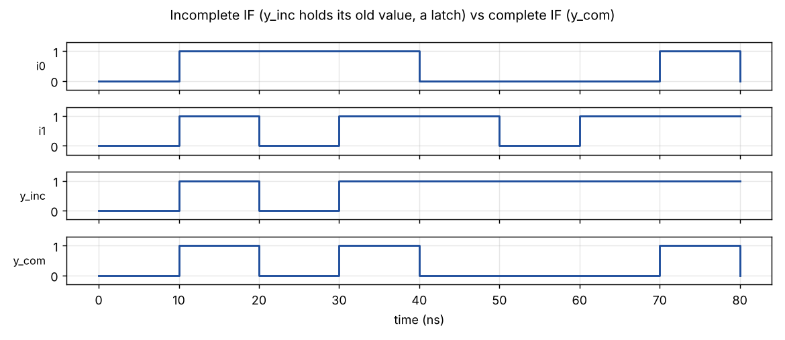
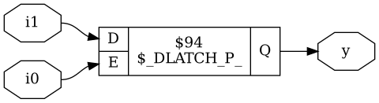
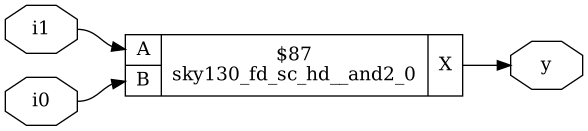

# Module 5 – RTL Optimization

## Overview

This module covers IF and CASE statements, how incomplete ones create latches, and loops used to build repeated hardware.

## Topics Covered

### 1. IF and CASE

- Priority logic from IF-ELSE
- Parallel selection from CASE
- Incomplete IF and CASE create latches

### 2. Latch Inference

- Why latches are usually unwanted
- Writing a default branch
- Bad case and partial case assignment

### 3. Loops and Generate

- FOR loop in an always block
- FOR-GENERATE for repeated instances
- MUX and DEMUX with generate, ripple-carry adder

## My Work

Day 5 contains the incomplete IF/CASE, bad case, MUX/DEMUX generate and ripple-carry adder experiments.

- [Day_5](../Day_5)

## Examples and Results

Simulation and synthesis results for small example designs, using Icarus Verilog and Yosys with the SKY130 HD cell library. The Verilog files are in the `examples` folder, so every result can be reproduced.

Example files: [incomplete_if.v](examples/incomplete_if.v), [tb_incomplete_if.v](examples/tb_incomplete_if.v)

### Incomplete IF against complete IF

With no else branch, y_inc holds its last value when i0 is 0. The complete IF (y_com) goes to 0 instead.

### Incomplete IF after synthesis

Yosys infers a latch (`$_DLATCH_P_`). The latch has no cell mapped here because the hold logic is not a normal flip-flop.

### Complete IF after synthesis

Adding the else branch gives plain logic: a single `and2` gate and no latch.
