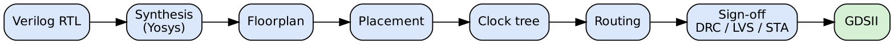
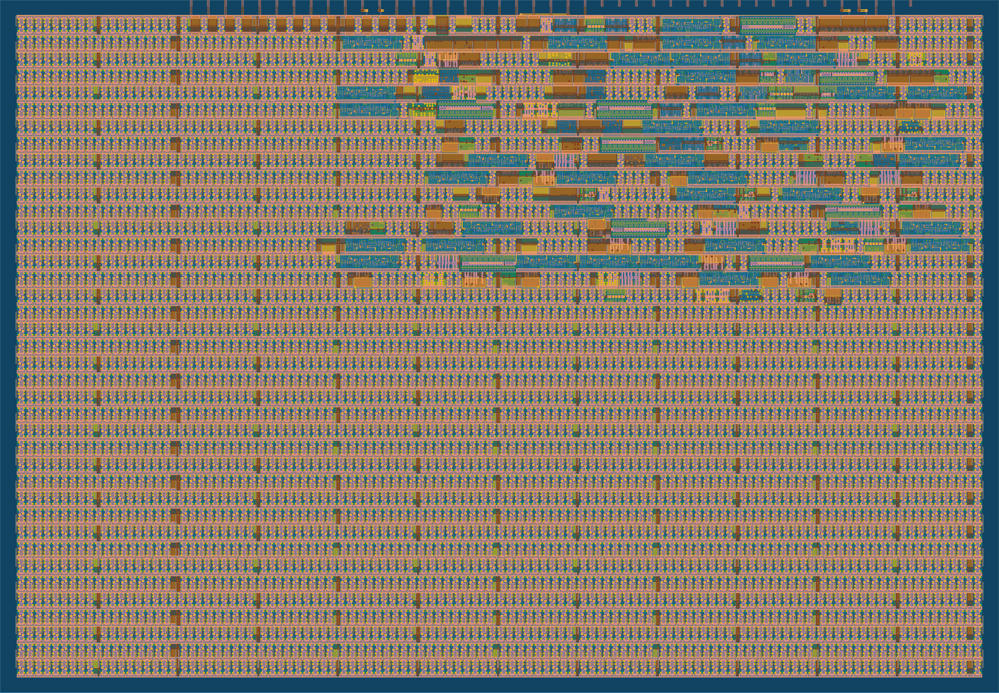

# Module 6 – OpenLANE and SKY130

## Overview

This module introduces the open-source RTL-to-GDS flow and the SKY130 process design kit.

## Topics Covered

### 1. Why Open-Source EDA

- Open tools and open PDKs
- SKY130 as a teaching and shuttle process

### 2. RTL to GDSII Flow

- Synthesis
- Floorplan and placement
- Clock tree and routing
- Sign-off: DRC, LVS and timing

### 3. OpenLANE

- Design configuration
- Directory structure of a run
- Reading the synthesis and timing reports

## My Work

The Assessment project ran this kind of flow through the Tiny Tapeout (LibreLane) tool: synthesis, layout, DRC, LVS and timing. The reports are in Assesment-1/project/physical_design.

- [Assesment-1](../Assesment-1)

## Examples and Results

The flow diagram is drawn for this module. The layout image is the real result of the Assessment 1 project (see [Assesment-1](../Assesment-1)).

### RTL to GDS flow

The steps from RTL to a GDSII layout.

### Layout of the Assessment 1 project

The real GDS render of the pedestrian crossing controller from the Tiny Tapeout flow.
