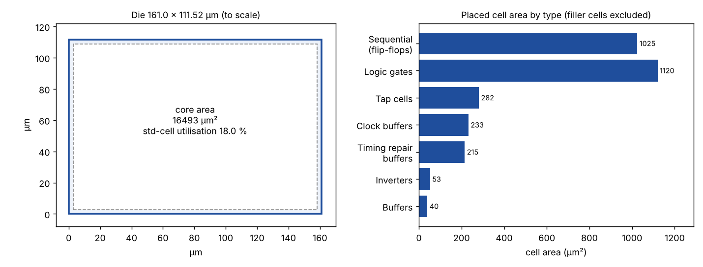

# Module 7 – Floorplanning, Library Cells and Placement

## Overview

This module covers the first physical steps of the flow, from the chip outline to where each cell sits.

## Topics Covered

### 1. Floorplanning

- Core utilisation and aspect ratio
- Pre-placed cells and decoupling capacitors
- Power planning and pin placement

### 2. Placement

- Library binding and global placement
- Placement optimisation
- Legalisation

### 3. Library Cells and Timing

- Cell characterisation
- Timing parameters such as delay, slew and setup/hold
- Viewing the layout in Magic or KLayout

## My Work

The final layout of the Assessment project (GDS image and reports) is in Assesment-1.

- [Assesment-1](../Assesment-1)

## Examples and Results

The figures below are drawn from the real report of the Assessment 1 project (see [Assesment-1](../Assesment-1)).

### Floorplan and placement summary of Assessment 1

Die and core size, and placed cell area by type. The numbers come from the project's `final_metrics.json` report.
